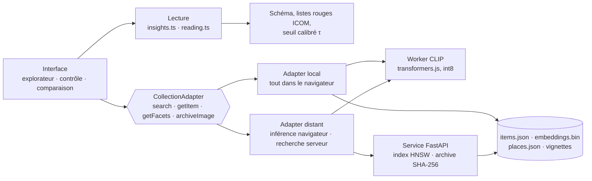
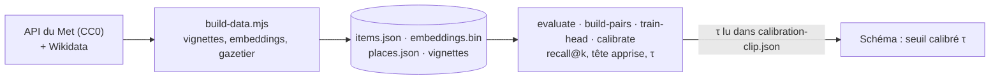

# svelte-collection-explorer

Front d'exploration de collections (recherche texte, recherche par image, filtres, comparaison),
écrit avec **Svelte 5**, **SvelteKit 3** et **TypeScript**. Le code est volontairement compact :
chaque fichier illustre un mécanisme de Svelte. Ce README le parcourt comme un tutoriel.

## Vue d'ensemble

Un agent photographie un objet ; l'application le compare à des objets de référence et dit ce qu'il est
probablement, d'où il vient probablement, et si cette combinaison figure sur une Liste rouge. L'interface
dépend du contrat `CollectionAdapter`, pas de l'implémentation du moteur : deux moteurs existent, l'un
entièrement dans le navigateur, l'autre avec un index côté serveur.



Hors parcours, la préparation des données et les mesures, qui produisent ce que l'application consomme :



Le détail — 46 briques, 72 liens, fichier par fichier — est sur la page interactive
[**architecture.html**](https://tatianat13.github.io/svelte-collection-explorer/architecture.html)
(ou `static/architecture.html` en local) : au survol d'une brique, ses liens directs s'animent dans le sens des
données et le reste s'estompe ; six parcours rejouent un flux complet pas à pas. GitHub rend le Markdown sans
script, c'est pourquoi la version animée est une page à part. Le parcours de la donnée elle-même, octet
par octet (ce que devient une image, où l'information se perd, les tailles à chaque étape), est dans
[`docs/parcours-donnee.md`](docs/parcours-donnee.md).

```bash
npm install
npm run dev      # http://localhost:5173
npm run check    # svelte-check : types + accessibilité
npm run build    # bundle de production dans .svelte-kit/output
```

---

## 1. Comment Svelte fonctionne

Svelte est un **compilateur**, pas une librairie chargée au runtime. Un fichier `.svelte` est
transformé au build en JavaScript natif qui manipule le DOM directement. Il n'y a pas de DOM virtuel
ni de diff : le compilateur sait quelles variables alimentent quel nœud et génère le code de mise à
jour minimal.

Un composant tient dans un seul fichier, en trois blocs :

```svelte
<script lang="ts">
  // logique : état, props, fonctions
</script>

<!-- markup : HTML + blocs de contrôle {#if} {#each} -->

<style>
  /* CSS scoppé au composant */
</style>
```

**SvelteKit** est le framework au-dessus : routage par fichiers, rendu côté serveur (SSR),
chargement de données, build Vite. Ce projet n'utilise que le routage et le SSR par défaut.

---

## 2. Structure du projet

```
scripts/build-data.mjs         # constitution du jeu de données (API du Met, vignettes, embeddings)
scripts/build-samples.mjs      # images d'exemple : vues alternatives d'objets du jeu de données
scripts/evaluate.mjs           # mesure : recall@k, MRR sur vues alternatives, cohérence de l'index
scripts/build-pairs.mjs        # paires (principale, vue alternative) du Met, embarquées : calibration et expériences
scripts/calibrate.mjs          # prédiction conforme : τ, couverture, rejet hors base
scripts/lib/                   # models.mjs (CLIP, DINOv2-small, même interface), metrics.mjs (cosinus, partition, corpus)
experiments/                   # hors application : train-head.mjs (projection apprise), rerank.mjs (MaxSim sur patches)
docs/propositions.md           # feuille de route : toutes les propositions d'avancement, état et mesures
eval/                          # jeu de requêtes, résultats, têtes apprises, calibrations, banc d'index (images, caches et paires ignorés par git)
service/main.py                # service d'index (FastAPI + hnswlib) pour l'adapter distant ; archive avec SHA-256 vérifié
service/bench.py               # passage à l'échelle : force brute contre HNSW, 1 000 → 100 000 vecteurs
docs/vision-cible.html         # maquette de l'outil complet : parcours de l'agent et architecture
static/architecture.html       # schéma interactif des briques : survol → liens animés, parcours rejoués pas à pas
e2e/explore.spec.ts            # parcours Playwright sur le build statique
src/
  app.html                     # squelette HTML, SvelteKit injecte %sveltekit.head% et %sveltekit.body%
  service-worker/index.ts      # hors ligne : application, données et vignettes en cache (projet TypeScript à part)
  routes/
    +layout.ts                 # prerender = true, trailingSlash = 'always' (build statique)
    +layout.svelte             # enveloppe toutes les pages (nav, thème)
    +page.svelte               # route "/" : explorateur (recherche, filtres, comparaison)
    controle/+page.svelte      # route "/controle" : parcours de contrôle en trois étapes
    compare/+page.svelte       # route "/compare"
  lib/                         # importable via l'alias $lib
    api/
      types.ts                 # contrats de données
      adapter.ts               # interface CollectionAdapter
      localAdapter.ts          # jeu de données statique + recherche par image dans le navigateur (défaut)
      remoteAdapter.ts         # index dans un service séparé, inférence dans le navigateur (VITE_ADAPTER=remote)
      shared.ts                # ce que les deux adapters partagent : gazetier, vignettes, vecteur de requête
      mockAdapter.ts           # données générées, sans modèle (VITE_ADAPTER=mock)
      filtering.ts             # filtrage et recherche texte, purs et testés
      insights.ts              # lecture agrégée des meilleurs résultats (identification, provenance)
      imageInfo.ts             # extraction EXIF/IPTC/XMP côté client
      index.ts                 # point d'entrée : quel adapter est actif
    ml/embedder.ts             # client : envoie les images au worker, repli sur le fil principal
    ml/embed.worker.ts         # Web Worker : modèle CLIP (transformers.js) et calcul des embeddings
    ml/status.svelte.ts        # progression du chargement du modèle
    stores/query.svelte.ts     # dernière photo de référence (pour l'export du dossier)
    utils/imgFallback.ts       # repli vignette si l'image grand format ne charge pas
    utils/caseFile.ts          # dossier de contrôle : construction et export JSON
    utils/photoQuality.ts      # contrôle qualité de la photo : netteté, exposition, contraste, taille, reflets
    api/reading.ts             # lecture d'un Insights : fiabilité, confiance, hésitations, risques (partagé)
    i18n/messages.ts           # textes d'interface par langue (fr, en)
    i18n/index.svelte.ts       # store de langue : i18n.locale, i18n.t(), i18n.l()
    config/schema.ts           # schéma des métadonnées (pilote l'UI), libellés multilingues
    config/countries.ts        # codes ISO 3166 + noms localisés via Intl.DisplayNames
    config/risk.ts             # Listes rouges ICOM : origine × catégorie → signal de risque
    stores/places.svelte.ts    # gazetier Wikidata : libellés, hiérarchie, coordonnées, options de filtre
    components/MapView.svelte  # carte des résultats (Leaflet), lieu de la photo à part
    config/vocabularies.ts     # vocabulaires contrôlés (types, matériaux, techniques, périodes, sujets)
    components/Logo.svelte     # marque : écrin hexagonal en trois chevrons, cœur turquoise
    components/ModelStatus.svelte # progression du modèle de reconnaissance
    components/InsightsPanel.svelte # identification et provenance probables, alerte, décision
    components/ExtraViews.svelte    # vues supplémentaires d'un même objet, fusionnées dans la requête
    components/*.svelte        # composants réutilisables
    stores/compare.svelte.ts   # sélection pour comparaison (persistée en session)
    stores/theme.svelte.ts     # thème clair / sombre / système (localStorage)
    utils/urlState.ts          # état de recherche <-> paramètres d'URL
    utils/labels.ts            # formatage des valeurs selon le schéma
    utils/flag.ts              # emoji drapeau depuis un code ISO
    utils/resizeImage.ts       # réduction de l'image côté client avant envoi
```

**Routage** : chaque dossier sous `src/routes` est une URL. `+page.svelte` est la page,
`+layout.svelte` l'enveloppe commune. Un `+layout.svelte` à la racine s'applique à toutes les routes
en dessous.

---

## 3. Les runes de Svelte 5

Svelte 5 remplace la réactivité implicite (`let x` + `$:`) par des **runes** : des fonctions
spéciales préfixées `$` que le compilateur reconnaît. Toutes sont utilisées dans ce projet.

### `$state` : une valeur réactive

```ts
// src/routes/+page.svelte
let text = $state('');
let page = $state(1);
let result = $state<SearchResult | null>(null);
```

Modifier la variable (`page++`, `text = '...'`) met à jour tout ce qui la lit dans le markup.
Les objets et tableaux déclarés avec `$state` sont des proxies profonds : `filters.origin = 'Ukraine'`
déclenche aussi la mise à jour.

### `$derived` : une valeur calculée

```ts
const totalPages = $derived(result ? Math.ceil(result.total / result.pageSize) : 1);
```

Recalculée uniquement quand `result` change. Pour un calcul sur plusieurs lignes, `$derived.by(() => {...})`
(voir `MetadataValue.svelte`).

### `$effect` : exécuter du code quand des dépendances changent

```ts
$effect(() => {
  void text; void image; void filters; void page;   // dépendances lues explicitement
  runSearch();
});
```

Le `$effect` suit automatiquement les valeurs réactives **lues de façon synchrone** dans son corps.
Ici `runSearch()` est asynchrone, donc ses lectures ne seraient pas suivies : on lit les
dépendances en tête pour les déclarer. Un effet peut retourner une fonction de nettoyage, exécutée
avant la prochaine exécution ou à la destruction :

```ts
$effect(() => {
  const f = image;
  if (!f) { imageInfo = null; return; }
  let cancelled = false;
  extractImageInfo(f).then((info) => { if (!cancelled) imageInfo = info; });
  return () => { cancelled = true; };   // évite d'écrire un résultat obsolète
});
```

Règle : `$effect` sert aux effets de bord (appels réseau, DOM, timers). Pour dériver une valeur,
toujours préférer `$derived`.

### `$props` : recevoir des propriétés

```ts
// src/lib/components/ResultCard.svelte
let { item }: { item: CollectionItem } = $props();
```

Déstructuration typée. Valeur par défaut : `let { pageSize = 12 } = $props();`.

### `$bindable` : une prop modifiable par l'enfant

```ts
// src/lib/components/ImageUpload.svelte
let { file = $bindable<File | null>(null), onchange } = $props();
```

Le parent écrit `<ImageUpload bind:file={image} />`. Quand l'enfant fait `file = f`, la variable
`image` du parent change aussi. Sans `$bindable`, une prop est en lecture seule.

---

## 4. Le markup

### Blocs de contrôle

```svelte
{#if loading}
  Chargement…
{:else if result}
  {result.total} résultats
{/if}

{#each result.items as item (item.id)}
  <ResultCard {item} />
{/each}
```

La **clé** `(item.id)` dans `{#each}` est importante : sans elle, Svelte réutilise les nœuds par
position et une suppression en milieu de liste déplace l'état des composants.

`{item}` est un raccourci pour `item={item}`.

### Événements

En Svelte 5, les événements sont des propriétés ordinaires : `onclick`, `oninput`, `ondrop`.

```svelte
<button onclick={() => page++}>Suivant</button>
<input oninput={(e) => update(field.key, e.currentTarget.value)} />
```

Pour qu'un composant remonte un événement au parent, on passe une **fonction en prop**
(`onchange` dans `FilterPanel`). Il n'y a plus de `createEventDispatcher`.

### Liaisons `bind:`

```svelte
<input type="search" bind:value={text} />
<input type="checkbox" bind:checked={includeGps} />
<input bind:this={inputEl} type="file" hidden />
```

`bind:value` synchronise dans les deux sens. `bind:this` donne une référence au nœud DOM.

### Classes conditionnelles

```svelte
<article class="card" class:selected>          <!-- class:selected={selected} -->
<div class="grid" class:dim={loading}>
```

### Snippets et `{@render}`

Le layout reçoit la page courante comme **snippet** `children` et l'affiche :

```svelte
<!-- src/routes/+layout.svelte -->
let { children } = $props();
...
<main>{@render children()}</main>
```

C'est le remplacement du `<slot />` de Svelte 4.

---

## 5. État partagé : un store en `.svelte.ts`

Les runes fonctionnent aussi dans des modules TypeScript si le fichier se termine en
`.svelte.ts`. C'est ainsi qu'on partage un état entre pages sans librairie :

```ts
// src/lib/stores/compare.svelte.ts
function createCompareStore() {
  let items = $state<CollectionItem[]>(load());
  return {
    get items() { return items; },          // getter : la lecture reste réactive
    get count() { return items.length; },
    toggle(item) { ... },
    clear() { ... }
  };
}
export const compare = createCompareStore();
```

Deux points à retenir :

- On exporte un **objet avec des getters**, pas la variable `items` directement. Exporter une
  variable `$state` casserait la réactivité à l'import (on recevrait une copie de la valeur).
- Le store persiste dans `sessionStorage`. Comme SvelteKit rend d'abord côté serveur, où
  `sessionStorage` n'existe pas, l'accès est gardé par `browser` de `$app/environment`.

Dans un composant, `compare.count` ou `compare.has(id)` se mettent à jour tout seuls.

---

## 6. CSS scoppé, variables et thème

Le `<style>` d'un composant ne s'applique qu'à son propre markup : le compilateur ajoute une classe
de hachage à chaque sélecteur. Pour sortir de ce périmètre, `:global()` :

```css
/* src/routes/+layout.svelte */
:global(:root) { --bg: #f6f7f9; --accent: #2563eb; ... }
@media (prefers-color-scheme: dark) { :global(:root) { --bg: #0f1216; ... } }
:global(body) { background: var(--bg); color: var(--fg); }
```

Les composants ne consomment que des variables CSS (`var(--accent)`), donc le thème clair/sombre
et le rebranding se font en un seul endroit.

---

## 7. Architecture : schéma + adapter

Le front est générique grâce à deux fichiers de configuration.

### Le schéma pilote l'interface

```ts
// src/lib/config/schema.ts
{ key: 'material', label: 'Matériaux', kind: 'vocab', vocabulary: 'material', multiple: true, filterable: true, group: 'Matériaux et techniques' }
```

Chaque champ déclare son `kind`, et les composants s'adaptent :

| `kind`     | Valeur stockée                | Options du filtre                | Libellé affiché                     |
|------------|-------------------------------|----------------------------------|-------------------------------------|
| `vocab`    | code d'un vocabulaire (`gold`)| multi-sélection, liste complète  | `termLabel()` dans la locale        |
| `country`  | code ISO 3166-1 (`UA`)        | multi-sélection, les 249 pays    | `Intl.DisplayNames` dans la locale  |
| `place`    | identifiant Wikidata (`Q1899`)| multi-sélection hiérarchique, un pays inclut ses lieux | gazetier : « Kyiv, Ukraine » |
| `select`   | chaîne libre                  | multi-sélection, facettes backend| la valeur telle quelle              |
| `text`     | chaîne libre                  | champ « contient »               | la valeur telle quelle              |
| `number`   | nombre                        | champ numérique (minimum)        | valeur + `unit`                     |
| `longtext` | texte long                    | —                                | texte multiligne                    |

- `FilterPanel` itère sur `filterFields` et génère le bon contrôle. Les listes sont des
  `MultiSelect` : plusieurs valeurs dans un même filtre se combinent en **OU**, les filtres entre
  eux en **ET**. Un filtre vide (`[]`) est ignoré.
- `ResultCard` affiche `cardFields`.
- La page Comparer affiche les champs **regroupés par `group`** et surligne les lignes différentes.
- `MetadataValue` traduit codes et tableaux de codes (`multiple: true`) en libellés.

Les champs suivent le standard **Object ID** (ICOM / Interpol / UNESCO), utilisé par les douanes et
la police pour décrire un bien culturel : type d'objet, matériaux et techniques, mesures,
inscriptions et marques, signes distinctifs, sujet, date ou période, auteur.

### Vocabulaires contrôlés : code stable, libellé traduit

```ts
// src/lib/config/vocabularies.ts
t('gold', 'Or', 'Gold'),
t('18th', 'XVIIIe siècle', '18th century', 140),   // 4e argument : ordre chronologique
```

Le principe est le même que pour les pays : les données contiennent le code, jamais le texte.
Avantages :

- **Pas de confusion** entre « Or », « or », « doré » : une seule clé `gold`.
- **Extensible** : ajouter une ligne suffit, les filtres, cartes et comparaisons se mettent à jour.
- **Multilingue** : `locale: 'en'` dans le schéma bascule tous les libellés. Un terme sans
  traduction retombe sur l'anglais, puis sur le code.
- **Trié correctement** : alphabétique localisé via `Intl.Collator`, ou ordre explicite (périodes).

Les listes sont inspirées des facettes du Getty AAT (Art & Architecture Thesaurus). Pour un projet
réel, on peut les remplacer par les identifiants AAT eux-mêmes et charger les libellés depuis le
backend, sans toucher aux composants.

### L'adapter isole le backend

```ts
// src/lib/api/adapter.ts
export interface CollectionAdapter {
  search(query: SearchQuery): Promise<SearchResult>;       // reçoit l'image réduite
  getItem(id: string): Promise<CollectionItem | null>;
  getFacets(): Promise<FacetValues>;
  archiveImage(original: File, info?: ImageInfo): Promise<ArchiveReceipt>; // reçoit l'original
}
```

La quatrième méthode, `archiveImage(original, info)`, reçoit l'image **non réduite** : la recherche
travaille sur une version légère, l'archivage d'un cas garde la pièce originale. Le mock renvoie un
accusé factice.

Les pages importent `api` depuis `#lib/api` et ne voient que cette interface. `mockAdapter.ts`
fournit 48 objets en mémoire avec une latence simulée. Pour brancher une vraie API :

1. Créer `src/lib/api/httpAdapter.ts` qui implémente `CollectionAdapter` avec `fetch`.
2. Dans `index.ts`, remplacer `export const api = mockAdapter` par le nouvel adapter.

Aucun composant ne change.

### Requêtes concurrentes

`runSearch` incrémente un compteur `requestId` et n'écrit le résultat que si l'identifiant est
toujours le dernier. Sans ça, une réponse lente d'une recherche précédente pourrait écraser une
réponse plus récente.

---

## 8. Données réelles et recherche par image dans le navigateur

Le jeu de démonstration est constitué de **64 objets du Metropolitan Museum of Art** (Open Access,
CC0) : vraies photos, vraies métadonnées, avec un accent sur l'Europe de l'Est, la Méditerranée
et le Proche-Orient. `npm run data` lance `scripts/build-data.mjs`, qui :

1. interroge l'API du Met sur une vingtaine de thèmes et garde les objets du domaine public avec image ;
2. traduit les champs du Met vers les codes du schéma (type, pays ISO, matériaux, techniques,
   période depuis la date, sujet depuis les tags) par règles de mots-clés. Pour le **pays d'origine**, le pays
   enregistré par le musée fait foi (`origin_basis: recorded`) ; à défaut, une règle sur la culture ou le style
   le déduit et l'objet le dit (`origin_basis: inferred`, affiché et filtrable). Pas de règle pour « byzantine »
   ni « tibet » : un empire sur trois continents et une région disputée ne se réduisent pas à un code ISO, l'origine
   reste vide. Sur les 64 objets : 22 enregistrées, 32 déduites, 10 vides. `npm run data -- --metadata-only` refait
   ces règles sans retélécharger les images ni recalculer les vecteurs. L'année est lue dans la
   **date affichée** par le musée (`objectDate`, « 1892 », « ca. 1570–80 »), pas dans la borne de
   recherche `objectBeginDate`, qui reflète souvent la période d'activité de l'artiste : un testeur
   avait relevé « 1837 » pour un tableau de 1892. La date textuelle est conservée telle quelle ;
3. enregistre des vignettes de 512 px dans `static/data/thumbs/` ;
4. calcule pour chaque vignette **stockée** un **embedding CLIP** (`Xenova/clip-vit-base-patch32`) et écrit
   `static/data/items.json` (métadonnées, champ `model`) et `static/data/embeddings.bin` (Float32, un
   vecteur par objet dans le même ordre : 128 Ko au lieu de 3 Mo de JSON).

Côté navigateur, `localAdapter.ts` charge ces deux fichiers une fois et garde une `Map` identifiant → vecteur. Quand une photo est déposée,
`ml/embedder.ts` confie le travail à un **Web Worker** (`ml/embed.worker.ts`) qui charge le **même
modèle** avec transformers.js (ONNX Runtime Web, ~90 Mo quantifiés, téléchargés une fois puis en
cache), calcule le vecteur de la photo et renvoie le résultat ; l'interface ne gèle jamais, même
pendant le chargement. Le modèle est préchargé dès qu'une image est choisie, avant même que la
recherche parte. Les objets sont classés par similarité cosinus ; les seuils « forte / moyenne /
faible » sont dans `schema.similarity`.

**Recherche par description.** CLIP a une seconde tour, textuelle, qui projette une phrase dans le même espace que
les images : « vase à figures rouges, deux anses » devient un vecteur de 512 nombres comparé aux objets par le même
cosinus. Le bouton **Par description** de l'explorateur bascule la barre de recherche dans ce mode : le texte n'est plus
un filtre sur les métadonnées mais une requête visuelle, vectorisée dans le même worker (tour texte de 64 Mo, chargée à
la demande, `embedText`). Avec une photo en plus, les deux vecteurs sont moyennés. Les scores texte → image sont plus
bas qu'image → image (0,2 à 0,35 pour une bonne correspondance) : ils classent, ils ne se comparent pas à τ, donc pas de
lecture agrégée ni d'ensemble conforme dans ce mode, seulement le classement. Mesure (`npm run evaluate -- --text`) : le
titre du musée de chaque objet (« Icon Fragment », « Amphora ») retrouve son image en premier dans **53 %** des cas, dans
les 5 premiers dans **88 %**, dans les 10 premiers dans **94 %** (MRR 0,66, score médian 0,29) sur les 64 objets. C'est la
fonctionnalité qu'un modèle auto-supervisé comme DINO ne peut pas offrir, et le cas « l'agent n'a qu'un signalement écrit ».
Limite : la tour texte de CLIP a été entraînée sur des légendes surtout anglaises. Le français marche (« manuscrit
enluminé » rend le lectionnaire en premier, « icône dorée du Christ » trois icônes), mais une description en anglais est
plus sûre, et les termes rares ou les motifs précis (« oiseaux affrontés ») sont mal compris.

**Lecture des résultats.** Une liste d'objets similaires ne répond pas à la question de l'agent.
`api/insights.ts` agrège les `topK` meilleurs résultats (12 par défaut, `schema.similarity.topK`),
pondérés par la similarité relative au meilleur (exp((s − best)/0,05) : à dix points du meilleur, un
objet pèse sept fois moins, donc une correspondance quasi exacte domine), en trois lectures affichées
par `InsightsPanel` :

- **ce que c'est probablement** : type, matériaux, période dominants, avec une confiance en mots ;
- **provenance probable** : parts par pays, cliquables pour filtrer, avec les objets de référence ;
- **catégorie surveillée** : si l'identification probable et une origine probable correspondent à
  une catégorie recensée dans une **Liste rouge ICOM** (`config/risk.ts`), une alerte explique quoi
  vérifier et renvoie à la source. Le vocabulaire est choisi pour ne pas être mal lu : le badge
  s'appelle « Catégorie surveillée », pas « Liste rouge », son contour est sobre, et chaque alerte
  commence par « ce n'est pas un signalement de cet objet ». Un bloc dépliable sous les résultats
  explique ce que le badge veut dire et ce qu'il ne veut pas dire. Seules les origines qui pèsent au
  moins 15 % de la provenance probable sont confrontées aux listes : 2 % d'Ukraine derrière 85 %
  d'Israël ne déclenchent rien. Un testeur extérieur avait lu le
  premier badge comme « cet objet est recherché » : c'est exactement l'erreur à éviter.

Si le meilleur objet de référence reste sous le seuil `similarity.reliable` (0,75, calibré : les
images sans rapport plafonnent à 0,72, les vraies correspondances dépassent 0,9), la lecture est
marquée **non fiable** : confiance « faible », aucun signal de risque, et un bandeau le dit en clair. Une photo
sans rapport avec la collection ne doit jamais produire une alerte.

L'agent enregistre ensuite une **décision** (retenir, laisser passer, demander un avis), reprise
dans l'export du dossier avec le résumé de la lecture. Le calcul est dans l'adapter : un backend
le ferait côté serveur avec le même contrat.

**Géographie plus fine que le pays.** Le script de données lit la ville, le site de fouille ou la
région fournis par le musée, les résout dans **Wikidata** (recherche, puis chaîne administrative
P131 jusqu'au pays, coordonnées P625) et écrit un gazetier `static/data/places.json`. Chaque objet
porte l'identifiant du lieu le plus précis connu, ou celui du pays. Côté front :

- le filtre **Lieu** est hiérarchique : cocher un pays inclut ses villes et régions ;
- la provenance probable détaille sous chaque pays les lieux dominants (« Ukraine 72 %, dont Kyiv 50 % ») ;
- une **carte** regroupe l'ensemble des résultats par lieu, cercle pointillé pour un pays seulement,
  plein pour un lieu précis, teinte selon la meilleure similarité ; un clic filtre sur ce lieu.

La **position GPS de la photo** n'entre jamais dans la provenance : elle dit où la photo a été prise,
pas d'où vient l'objet. Si l'agent a autorisé son envoi, elle apparaît comme un marqueur distinct,
légendé « lieu de la photo ».

**Contrôle qualité de la photo.** Avant l'analyse, `utils/photoQuality.ts` mesure sur une
version réduite : variance du laplacien rapportée à la variance de luminance (netteté
indépendante de l'exposition, pour ne pas dire « floue » une photo simplement sombre), luminance moyenne (sombre / surexposée),
écart-type (contraste), part de pixels saturés (reflets), petit côté (taille utile, calculée sur la
zone cadrée si elle existe). Chaque défaut vient avec un geste concret : « rapprochez-vous »,
« changez d'angle ». Rien ne bloque, mais le bouton devient « Analyser quand même ». Les seuils
sont dans `schema.photoQuality`. Sur le terrain, la plupart des mauvais résultats viennent de la
prise de vue : autant le dire avant plutôt qu'afficher une certitude fausse après.

**Hésitation.** `api/reading.ts` concentre la lecture des résultats, partagée par l'explorateur et
la page Contrôle. Quand deux types ou deux origines sont trop proches (la première hypothèse sous
55 %, la seconde au-dessus de 25 %, moins de 20 points d'écart), le panneau affiche les deux, plafonne
la confiance à « moyenne », examine les listes rouges pour les deux types, et conseille une vue
supplémentaire. L'agent préfère une hésitation honnête à une certitude fausse.

**Recadrage.** Tracer un cadre sur l'aperçu limite la recherche à cette zone : l'objet est rarement
seul sur une photo de terrain. L'original reste intact pour les métadonnées et l'archivage ; seule
la zone découpée (puis réduite) part à la recherche. Le classement change immédiatement.

Ce que ça change :

- **La recherche par image est réelle**, sans serveur : elle tourne sur GitHub Pages.
- **La photo ne quitte jamais l'appareil.** Pour des agents qui photographient des pièces sous
  contrôle, c'est un argument de confidentialité fort.
- transformers.js est chargé par `import()` dynamique : le bundle principal ne grossit pas, le
  modèle n'est demandé qu'au premier envoi d'image.
- L'adapter HTTP d'un vrai backend remplacera cet adapter sans toucher aux composants ; le
  backend calculera alors les embeddings sur ses propres images, avec le modèle de son choix.

---

## 9. Le parcours de contrôle

`/controle/` reprend la maquette `docs/vision-cible.html` à l'écran près : sur grand écran, les
**trois écrans sont côte à côte** dans des cadres de téléphone, l'étape active est mise en avant,
les deux autres montrent ce qu'elles attendent ; sur téléphone, un seul écran à la fois avec des
onglets. Chaque cadre a sa barre d'état (heure, en ligne / hors ligne, durée d'analyse, numéro de
dossier).

1. **Photo** : dépôt, appareil photo ou collage, recadrage, puis **autres vues** (dos, marque,
   détail) : chaque vue est vectorisée et les vecteurs sont moyennés en une seule requête
   (`localAdapter.averageNormalized`). Le bouton Analyser ne s'active que lorsque l'image réduite
   est prête.
2. **Résultat et décision** : ce que c'est probablement avec la confiance en mots, provenance
   probable, alerte Liste rouge, « Pourquoi » avec trois objets de référence et les attributs
   dominants en langage courant, puis Retenir / Laisser passer, ou avis d'expert.
3. **Dossier** : décision, motif, nombre de photos, empreinte, horodatage ; Expertise et
   Recherches associées affichent « à connecter » et « non connecté » plutôt que des valeurs
   inventées. Export JSON et impression via `utils/caseFile.ts`, partagé avec la page Comparer.

Le dossier vit en session (`stores/query.svelte.ts`) : un rechargement après décision rouvre
directement l'étape 3, et passer par l'explorateur ne le perd pas. L'explorateur reste la vue
experte, avec filtres et comparaison.

---

## 10. Métadonnées des images

`src/lib/api/imageInfo.ts` lit, côté client, EXIF/IPTC/XMP (librairie `exifr`), les dimensions
réelles (via un `Image()` en mémoire) et un SHA-256 (`crypto.subtle`). Les trois s'exécutent en
parallèle avec `Promise.all`.

Le panneau `ImageInfoPanel` affiche le résultat, signale une image sans aucune métadonnée, et
propose d'exclure la position GPS avant l'envoi (`withoutGps`). Les infos partent dans
`SearchQuery.imageInfo`.

Ces données sont **indicatives** : souvent absentes (messageries, réseaux sociaux, captures d'écran)
et falsifiables. Le backend doit refaire l'extraction de référence et calculer un hash perceptuel.

---

## 11. Multilingue

Trois couches, toutes pilotées par un seul store `i18n` (`src/lib/i18n/index.svelte.ts`) :

| Quoi | Où | Comment |
|---|---|---|
| Textes d'interface (boutons, messages, aria-labels) | `i18n/messages.ts` | `i18n.t('results.count', { n })` ; une clé `_plural` est choisie quand `n !== 1` |
| Libellés du schéma (champs, groupes, nom de la collection) | `config/schema.ts` | objets `{ fr, en }`, lus par `i18n.l(label)` |
| Vocabulaires et pays | `config/vocabularies.ts`, `config/countries.ts` | `termLabel(vocab, code, i18n.locale)`, `Intl.DisplayNames` |

- La langue est détectée dans l'ordre : `localStorage`, langue du navigateur, français. `LanguageSwitch`
  l'enregistre et met à jour `<html lang>`.
- `i18n.locale` est un `$state` : tout composant qui le lit, directement ou via `t()` / `l()`, se
  met à jour quand la langue change. Aucun rechargement.
- Les données ne contiennent que des codes ; seul l'affichage est traduit. Le mock recalcule titres
  et descriptions à chaque requête, un vrai backend recevrait `Accept-Language`.
- Pour ajouter une langue : une entrée dans `messages`, une dans `locales`, les libellés du schéma,
  et une colonne dans les vocabulaires (repli sur l'anglais sinon).

---

## 12. Détails d'interface côté utilisateur

Quelques mécanismes qui font la différence à l'usage, et comment ils sont faits en Svelte.

| Détail | Fichier | Mécanisme |
|---|---|---|
| Badge « Liste rouge » sur les cartes et alerte dans le volet | `ResultCard.svelte`, `ItemDrawer.svelte` | `riskFor(item)` croise origine et catégorie avec les règles ICOM |
| « Essayer avec une image d'exemple » | `SampleImages.svelte`, `scripts/build-samples.mjs` | vues alternatives (dos, détail) d'objets de la collection, fournies par le Met : proches mais pas identiques, donc une vraie démonstration sans préparer de photo |
| Contrôle qualité de la photo | `PhotoQuality.svelte` | verdict et conseils sous la zone de dépôt, recalculé si la zone cadrée change |
| Hésitation entre deux hypothèses | `InsightsPanel.svelte`, `controle/+page.svelte` | bloc dédié issu de `readInsights`, même règle partout |
| Recadrer la photo avant recherche | `ImageUpload.svelte` | cadre tracé au pointeur sur l'aperçu, découpe dans un canvas, l'original est conservé |
| Position GPS exclue par défaut | `+page.svelte` | `includeGps = false` : la position ne part que si l'agent le demande |
| Délai sur la saisie (250 ms) | `+page.svelte` | `$effect` avec `setTimeout` et nettoyage : `text` (saisie) alimente `query` (recherche) |
| Carte des résultats | `MapView.svelte` | un cercle par lieu, taille selon le nombre d'objets ; couleur selon le meilleur score seulement quand il y a une recherche par image (sinon la légende le dit) ; **cliquer un cercle filtre sur ce lieu**, et la légende l'annonce |
| Volet de détail | `ItemDrawer.svelte` | sous 1 400 px, volet modal avec voile ; au-delà, il **pousse** le contenu (classe `drawer-open` sur `<html>`, `+layout.svelte`) : la liste et la carte restent visibles et cliquables ; inventaire nommé (« inv. ») avec lien vers la fiche du musée |
| Export du dossier et impression | `compare/+page.svelte`, `utils/caseFile.ts` | JSON rejouable : modèle et révision du navigateur, base interrogée (`adapter.info()` : modèle, taille, date, moteur), seuils en vigueur (τ calibré et sa source), photo de référence (empreinte, pas l'image), lecture (meilleur score, fiabilité, ensemble conforme, risques) et candidats avec scores ; feuille de style `@media print` pour un PDF propre |
| Piège de focus dans le volet | `ItemDrawer.svelte` | Tab et Maj+Tab restent dans le dialogue, le focus revient à l'élément d'origine à la fermeture |
| Hors ligne | `service-worker/index.ts` | application, données et vignettes en cache à l'installation ; le modèle est mis en cache par transformers.js ; l'image grand format retombe sur la vignette |
| Prendre une photo sur mobile | `ImageUpload.svelte` | second `<input type="file" capture="environment">`, bouton visible seulement sur écran tactile |
| Image réduite avant envoi | `utils/resizeImage.ts`, `schema.upload` | politique configurable : `maxPx` (1600), `skipBelowBytes` (2 Mo, en dessous rien n'est touché), `quality` ; l'original reste côté client pour l'aperçu, les métadonnées et `adapter.archiveImage` |
| Déposer une image **n'importe où** sur la page | `+page.svelte` | `<svelte:window ondragenter ondrop …>` + compteur de profondeur pour l'overlay |
| Coller une image (⌘/Ctrl + V) | `+page.svelte` | `onpaste` sur `window`, lecture de `clipboardData.items` |
| `/` pour aller à la recherche, Échap pour effacer / fermer | `+page.svelte` | `onkeydown` global, ignoré quand on tape déjà dans un champ |
| URL partageable (`?q=…&origin=UA,RU&p=2`) | `utils/urlState.ts` | lecture de `page.url` à l'init, `goto(url, { shallow: true, replace: true })` dans un `$effect` |
| Filtres à sélection multiple avec recherche interne | `MultiSelect.svelte` | accordéon, cases à cocher natives, puces des valeurs cochées, Échap referme |
| Case à cocher à côté de chaque attribut d'une carte ou du volet : « objets semblables » | `AttributeList.svelte` | liste [case] attribut valeur, une ligne par valeur ; le composant reçoit `filters` et un callback ; cocher ajoute la valeur au filtre, décocher la retire |
| Puces de filtres actifs, une par valeur, supprimables | `FilterChips.svelte` | `$derived` sur `filters`, libellés via le schéma |
| Volet de détail sans quitter la page | `ItemDrawer.svelte` | `role="dialog"`, focus sur le bouton Fermer, scroll du body bloqué dans un `$effect` avec nettoyage |
| Barre flottante de comparaison | `CompareTray.svelte` | lit le store `compare`, `transition:fly` |
| Score de similarité | `ScoreRing.svelte` | anneau SVG (`stroke-dasharray`), chiffre + libellé, jamais la couleur seule |
| Squelettes au premier chargement, barre de progression ensuite | `SkeletonCard.svelte`, `+page.svelte` | pas de clignotement : on ne vide jamais la grille pendant une recherche |
| Thème clair / sombre | `stores/theme.svelte.ts`, `app.html` | attribut `data-theme`, appliqué avant le premier rendu pour éviter le flash |
| Drapeau à côté de l'origine | `utils/flag.ts` | indicateurs régionaux Unicode calculés depuis le code ISO |
| Comparaison visuelle synchronisée | `ImageCompare.svelte` | zoom à la molette et déplacement liés entre toutes les images, superposition avec curseur d'opacité pour deux objets |
| « Différences seulement » et « Copier le tableau » | `compare/+page.svelte` | `$derived` sur les groupes, `navigator.clipboard` en TSV collable dans un tableur |
| Filtres en tiroir sur mobile | `+page.svelte` | `position: fixed` + `transform` sous 820 px, bouton « Filtres » avec compteur |

Deux couleurs d'accent, volontairement distinctes : le bleu pour la **recherche et les filtres**
(puces, cases d'attributs, compteur de filtres), le vert-bleu `--compare` pour la **sélection**
(bouton pilule à icône balance, contour de carte, barre flottante, compteur du menu). L'utilisateur
sait d'un coup d'œil s'il agit sur la liste ou sur sa sélection.

**Marque.** Un écrin hexagonal ouvert, trois chevrons autour d'un cœur turquoise : l'objet protégé
au centre, les ouvertures pour l'explorer. `static/favicon.svg` (tuile encre, chevrons clairs, cœur vert-bleu, lisible
à 16 px), déclinaisons PNG en 16 et 32 px pour Safari et les anciens navigateurs,
`apple-touch-icon.png` (180 px) et `manifest.webmanifest` avec icônes 192 et 512 px pour l'ajout à
l'écran d'accueil, le tout rendu depuis le SVG, et `Logo.svelte` dans la barre,
dont les chevrons prennent la couleur du texte et le cœur la couleur de sélection du thème courant.

Règles suivies : jamais d'information portée par la couleur seule, `:focus-visible` partout,
`prefers-reduced-motion` respecté pour les animations, cibles tactiles ≥ 32 px.

---

## 13. SSR : ce qu'il faut savoir

SvelteKit rend chaque page une première fois côté serveur, puis l'« hydrate » dans le navigateur.
Conséquences dans ce projet :

- `onMount` ne s'exécute que dans le navigateur : on y charge les facettes.
- `$effect` ne s'exécute jamais côté serveur.
- `theme.svelte.ts` et `i18n/index.svelte.ts` lisent `localStorage` à l'import, gardés par `browser` ;
  `ThemeToggle` et `LanguageSwitch` calculent leur valeur dans `onMount` pour que le HTML serveur et
  le premier rendu client coïncident.
- Tout accès à `window`, `sessionStorage`, `URL.createObjectURL` doit être gardé par `browser`
  ou placé dans un effet/`onMount`.
- `page` de `$app/state` donne l'URL courante de façon réactive (utilisé pour `aria-current` dans la nav).

---

## 14. Déploiement

Le front est statique : `@sveltejs/adapter-static` pré-rend les deux pages en HTML, le mock tourne
dans le navigateur. Le workflow `.github/workflows/deploy.yml` publie sur **GitHub Pages** à chaque push sur
`main`, après la chaîne complète : `npm audit --omit=dev`, lint, types, tests unitaires avec seuil de
couverture, build, parcours de bout en bout, et les tests du service Python dans un job parallèle.

Deux autres workflows tournent sans intervention :

- `evaluation.yml` rejoue la mesure de recherche (`scripts/evaluate.mjs --check`) quand le moteur, les données
  ou les scripts changent, et chaque lundi : il échoue si recall@1, recall@5, category@1 ou le MRR perdent plus
  que ce qu'une seule requête sur 39 peut expliquer, ou si `embeddings.bin` s'écarte de plus de 0,02 de ce que le
  modèle épinglé produit (un autre modèle donne au moins 0,1 ; d'une machine à l'autre, décodage JPEG et exécution
  ONNX font ~0,01, mesuré 0,013 entre macOS et Linux). Le fichier `eval/results.json` versionné est la référence ;
  il n'est pas réécrit en CI.
- `data-refresh.yml` reconstruit le jeu de démonstration depuis l'API du Met le premier du mois, vérifie
  l'absence de régression et ouvre une pull request si les données ont changé.
- `dependabot.yml` propose les mises à jour npm, pip et GitHub Actions chaque semaine.

- `BASE_PATH` (`/svelte-collection-explorer`) est injecté au build ; en local il est vide.
- Les liens internes passent par `base` de `$app/paths`, jamais par `/` en dur.
- `trailingSlash: 'always'` produit `compare/index.html`, ce que Pages sert sans configuration.
- `static/.nojekyll` empêche Pages d'ignorer les dossiers commençant par `_`.

Pour un hébergement avec serveur (SSR, API), remplacer l'adapter par `adapter-node` ou celui de la
plateforme : le code applicatif ne change pas.

---

## 15. Tests

Trois niveaux, exécutés par le workflow avant chaque déploiement, plus la mesure de recherche à part :

- `npm run lint` : ESLint (règles recommandées JavaScript, TypeScript, Svelte), sans formateur. Un hook de
  pré-commit (`.githooks/`, installé par `npm install`) lance lint et tests unitaires avant chaque commit.
- `npm test` : Vitest sur les modules purs (sérialisation d'URL, libellés, filtrage et recherche
  texte, similarité, lecture agrégée et ensemble conforme, listes rouges, qualité photo), sur les deux adapters
  avec un `fetch` et un embedder simulés (chargement unique des données, refus d'un `embeddings.bin` de mauvaise
  taille, classement par cosinus, filtres avant tri, refus d'un index calculé avec un autre modèle, requête envoyée
  sans l'image, archivage multipart avec empreinte), sur les stores de session (photo de référence et décision,
  sélection pour comparaison) et sur le dossier exporté, plus deux tests de cohérence : la révision du modèle est la même dans le navigateur, l'index et les scripts, et le seuil τ du
  schéma vient bien du modèle du navigateur ; chaque fichier cité par `static/architecture.html` existe et
  chaque fichier de `src/` y figure. `npm run test:coverage` applique un seuil de 50 % de lignes sur l'ensemble de `src/lib`, fichiers jamais importés par un test compris (56 % mesurés ; le reste est du code de navigateur, canvas, worker, thème, couvert par les parcours de bout en bout).
- `npm run test:service` : 15 tests pytest du service (validation, recherche filtrée, archive, empreinte).
- `npm run evaluate`, `npm run calibrate`, `npm run robustness` : mesures de la recherche par image (§ 16). Elles téléchargent les
  modèles, donc elles vivent dans leur propre workflow (`evaluation.yml`, § 14) et non dans le déploiement.
- `npm run test:e2e` : Playwright sur le build statique servi sous le chemin de base de GitHub Pages
  (`e2e/`, Chromium, et WebKit pour les parcours d'interface afin de couvrir Safari). Dix parcours : filtres et URL partageable, recherche texte avec délai, attributs
  cochables, volet puis comparaison, volet au-dessus de la carte (contexte d'empilement de Leaflet), bascule de langue, page de contrôle, **deux recherches par image réelles** (le
  modèle CLIP est chargé dans le worker du navigateur, une vue alternative d'un objet du corpus est vectorisée, et
  l'objet doit sortir en premier avec le panneau de lecture affiché et aucune erreur de console) et **une recherche par
  description** (« manuscrit enluminé » doit rendre le lectionnaire en premier). Les poids
  (90 Mo) sont servis depuis le cache local de transformers.js quand il existe (en CI, celui du workflow
  d'évaluation, restauré avant les parcours), sinon depuis le Hub.

---

## 16. Évaluation chiffrée de la recherche par image

> **Expérimentation, pas intégration.** Tout ce chapitre est mesuré hors application, par des scripts. Le
> parcours applicatif reste sur CLIP ; DINOv2, la tête apprise et le ré-ordonnancement sont des expériences,
> et le moteur DINOv3 / Milvus de l'équipe n'est pas reproduit ici. Seule la calibration τ est intégrée.

Le Met fournit pour beaucoup d'objets des **vues alternatives** (dos, détail, autre angle). Une vue
alternative est une requête dont on connaît la bonne réponse : l'objet lui-même. C'est une vérité
terrain gratuite, qui permet de mesurer la recherche au lieu de la juger à l'œil.

```bash
npm run evaluate -- --build                       # constitue eval/queries.json : une vue par objet qui en a une (API du Met)
npm run evaluate                                  # CLIP sur ce jeu
npm run evaluate -- --models clip,dinov2-small    # plusieurs modèles, même jeu, même tableau
```

Le script recalcule les embeddings du corpus par modèle depuis `static/data/thumbs` (cache dans
`eval/cache/`), embarque chaque requête, classe les 64 objets par cosinus et relève le rang du bon
objet. Résultat dans `eval/results.json`, et ce tableau (64 objets, 39 requêtes, CPU, int8) :

| mesure | CLIP ViT-B/32 | DINOv2 small | DINOv2 base |
|---|---:|---:|---:|
| recall@1 | 64,1 % | **74,4 %** | 59,0 % |
| recall@5 | 89,7 % | **92,3 %** | 82,1 % |
| recall@10 | **94,9 %** | 92,3 % | 87,2 % |
| MRR | 0,765 | **0,827** | 0,710 |
| catégorie du top-1 correcte | 82,1 % | **89,7 %** | 74,4 % |
| origine du top-1 correcte | 71,8 % | **82,1 %** | 64,1 % |
| score médian de la bonne réponse | 0,855 | 0,766 | 0,836 |
| bonne réponse ≥ 0,75 (seuil « fiable ») | 84,6 % | 53,8 % | 87,2 % |
| marge médiane (bon objet − meilleur autre) | 0,051 | **0,110** | 0,016 |
| inférence médiane par image | 28 ms | 46 ms | 104 ms |
| dimension | 512 | 384 | 768 |

Trois lectures :

- **Pour retrouver *le même objet* sous un autre angle, DINOv2 small fait mieux que CLIP** : +10 points de
  recall@1 et une marge deux fois plus large entre le bon objet et le meilleur intrus. C'est attendu :
  DINOv2 est auto-supervisé sur la structure visuelle, CLIP sur le sens partagé avec une légende. Pour
  l'appariement d'instance, c'est la bonne famille ; CLIP garde l'avantage de la recherche par texte.
- **Les scores ne se comparent pas d'un modèle à l'autre.** CLIP tasse tout vers le haut (bonne réponse
  à 0,855, intrus à 0,80) ; DINOv2 étale (bonne réponse à 0,766, intrus bien plus bas). Les seuils de
  `schema.similarity` (0,75 fiable, 0,8 fort) sont **calibrés pour CLIP** : appliqués tels quels à DINOv2,
  ils rejetteraient la moitié des bonnes réponses. Changer de modèle impose de recalibrer, et ce script
  donne la distribution pour le faire (`truth>=…`, `medianMargin`).
- **L'index doit décrire exactement l'artefact servi.** La première passe a révélé un écart médian de
  0,019 (max 0,12) entre les embeddings de `items.json` et leur recalcul : l'index avait été calculé sur
  l'image en mémoire, pas sur la vignette JPEG réellement stockée. `build-data.mjs` relit maintenant la
  vignette enregistrée avant de l'embarquer, et les vecteurs vivent dans `embeddings.bin` (Float32, 128 Ko)
  à part des métadonnées ; l'écart recalculé est tombé à 0,0001.

Limites : 39 requêtes, c'est peu — assez pour orienter, pas pour conclure à deux points près. DINOv2
base derrière small est probablement un effet de la quantification int8 ou de l'échantillon ; à vérifier
en fp32 avant d'en tirer quoi que ce soit — il a été retiré de `scripts/lib/models.mjs`, on ne garde que ce
qu'on sait expliquer. Et une vue alternative est une requête facile (même objet,
même studio, même lumière) : une photo de terrain, floue, sous néon, sur fond de comptoir, fera moins bien.
La métrique d'acceptation reste la concordance avec des experts ; celle-ci sert à itérer avant.

### Affinage par métrique sans GPU : une projection apprise

Le *Met Dataset* (NeurIPS 2021) montre que sur des œuvres, l'apprentissage de métrique suivi d'un kNN
bat largement un classifieur. On n'a pas de GPU : on apprend donc une **projection linéaire W (384 × 384)**
sur les embeddings gelés de DINOv2-small, avec une perte contrastive InfoNCE symétrique sur des paires
(photo principale, vue alternative) et un rappel vers l'identité pour ne pas sur-apprendre.

```bash
npm run pairs -- --model dinov2-small --max 400     # 400 objets du Met avec vue alternative, embarqués (eval/pairs/)
npm run train -- --model dinov2-small              # experiments/train-head.mjs : W → eval/heads/ (non suivi par git ; gradient vérifié par différences finies)
npm run evaluate -- --models dinov2-small --head eval/heads/dinov2-small.json
```

Les 64 objets du corpus de démo sont exclus de l'entraînement. Partition par hash d'identifiant :
254 paires d'entraînement, 67 de calibration, 79 de test.

| DINOv2-small, 39 requêtes de démo | sans tête | avec tête |
|---|---:|---:|
| recall@1 | 74,4 % | 76,9 % |
| recall@5 | 92,3 % | 94,9 % |
| recall@10 | 92,3 % | 97,4 % |
| MRR | 0,827 | 0,848 |
| marge médiane (bon objet − meilleur intrus) | 0,110 | **0,179** |
| score médian de la bonne réponse | 0,766 | 0,695 |

Lecture honnête : sur le recall, l'écart est d'une requête sur 39 (et de −2 sur 40 en test réservé) — du
bruit. Ce qui change vraiment, c'est la **séparation** : la marge entre le bon objet et le meilleur intrus
augmente de 63 %, et les scores s'étalent. C'est précisément ce qui rend les ensembles conformes
ci-dessous quatre fois plus petits. Avec quelques milliers de paires et l'affinage du backbone, c'est le
recall qui bougerait.

### Prédiction conforme et rejet « inconnu »

Un cosinus n'est pas une probabilité, et un seuil fixe ne vaut que pour un modèle. La **prédiction
conforme** (RCIR, AAAI 2025) construit pour chaque requête un ensemble de candidats de taille adaptative
qui contient le bon objet avec une probabilité garantie 1 − α, sans réentraînement, pour n'importe quel
encodeur : τ_α = quantile d'ordre α des similarités du bon objet sur un jeu de calibration ; ensemble =
objets de similarité ≥ τ_α. Ensemble vide = « objet absent de la base ».

```bash
npm run calibrate -- --model dinov2-small                                   # embeddings bruts
npm run calibrate -- --model dinov2-small --head eval/heads/dinov2-small.json
```

Corpus de 107 photos principales, 67 requêtes de calibration, 40 requêtes d'objets présents, 39 requêtes
d'objets **retirés** du corpus (hors base) :

| α | garanti ≥ | couverture, brut | taille moy., brut | couverture, tête | taille moy., tête | singletons, tête |
|---:|---:|---:|---:|---:|---:|---:|
| 0,05 | 95 % | 92,5 % | 23,2 | 92,5 % | **5,5** | 7,5 % |
| 0,10 | 90 % | 92,5 % | 7,9 | 82,5 % | **3,8** | 7,5 % |
| 0,20 | 80 % | 75,0 % | 2,4 | 75,0 % | **1,7** | 30 % |

À 95 % de garantie, la tête ramène l'ensemble de 23 à 5,5 candidats en moyenne, à couverture égale :
pour un agent, « l'un de ces cinq » est utilisable, « l'un de ces vingt-trois » ne l'est pas. Les
couvertures légèrement sous la garantie (92,5 contre 95) sont l'effet de 40 requêtes de test et 67 de
calibration — la garantie vaut en espérance, et il faut des centaines de points pour la voir tenir à deux
points près.

**Rejet hors base.** Deux règles calibrées : ensemble vide (seuil absolu), et **marge top-1 − top-2**
inférieure à un quantile (un objet absent a un premier candidat sans avance nette). Marge médiane :
0,167 pour un objet présent contre 0,057 pour un objet absent (avec tête). Mais la queue basse des objets
présents (ceux que le modèle classe mal) recouvre les objets absents : à 10 % de faux rejets, on ne
rejette que **≈ 30 % des objets absents**, avec l'une ou l'autre règle. Dire « inconnu » de façon fiable
demande plus que la similarité globale — une vérification locale du top-1 (patches DINO, § propositions 3)
ou un modèle plus fort. C'est une limite mesurée, pas supposée.

**Dans l'application.** La même calibration, faite pour CLIP (le modèle du navigateur, 400 paires, 69 en
calibration), donne **τ = 0,747 à α = 0,1** — à trois millièmes du 0,75 qui était réglé à la main. Le seuil manuel a
donc été retiré : le schéma ne porte plus que `similarity.calibration` (modèle, α, τ, provenance), `readInsights`
en déduit un `ConformalSet`, et sans calibration il exige une similarité forte.

Ce que l'application **dit**, et pourquoi elle ne dit pas plus : « *n* références au-dessus du seuil calibré
τ = 0,75 ; seuil réglé pour une couverture visée de 90 % sur le jeu de calibration, non vérifié en conditions
réelles », et, quand rien ne dépasse τ, « résultat non concluant » — pas « objet absent de la base ». Les
chiffres l'imposent : sur CLIP, le seuil visant 90 % donne **81,6 % de couverture observée** sur 38 requêtes de
test et ne rejette que **2,7 %** des objets hors base. La propriété conforme tient en espérance, pour des requêtes
de même distribution que la calibration (vues de studio) ; elle n'est pas une promesse opérationnelle.

Une erreur corrigée au passage : la première version comptait l'ensemble sur les références déjà tronquées au
top-K, et ce sous-ensemble n'hérite pas de la propriété de l'ensemble complet. `computeInsights` compte
maintenant les objets ≥ τ sur **tout le classement** (`Insights.aboveTau`) ; en mode distant, sur les 200
candidats rapatriés, ce qui reste une borne. CLIP donne en moyenne 9,7 objets au-dessus de τ contre 3,8 pour
DINOv2 avec tête — un argument de plus pour changer d'encodeur, le jour où ce sera une intégration.

### Ré-ordonnancement par patches : retrouver un objet depuis un fragment

Un vecteur global décrit l'image entière. Quand l'agent n'a qu'un détail — un fragment, un objet à
moitié emballé — ce vecteur s'éloigne de celui de la fiche. DINOv2 produit aussi 256 **jetons de patch**
par image : on les utilise pour ré-ordonner les top-20 de la recherche globale.

```bash
npm run rerank -- --crops --topk 20                 # experiments/rerank.mjs, DINOv2-small
```

`--crops` simule des fragments par recadrage centré (70 % et 50 % du côté, soit 49 % et 25 % de la
surface). Deux scores locaux comparés : **voisins mutuels** (part des patches qui se choisissent
réciproquement, symétrique) et **MaxSim** (moyenne, sur les patches de la requête, de la meilleure
similarité dans le candidat — asymétrique, type ColBERT : un fragment est *contenu* dans l'objet).

| fragment | global seul | voisins mutuels | **MaxSim** | global + MaxSim |
|---|---:|---:|---:|---:|
| image entière, recall@1 | 74,4 % | 74,4 % | 74,4 % | 76,9 % |
| 70 % du côté, recall@1 | 66,7 % | 66,7 % | **74,4 %** | 66,7 % |
| 50 % du côté, recall@1 | 59,0 % | 56,4 % | **69,2 %** | 66,7 % |
| 50 % du côté, MRR | 0,713 | 0,670 | **0,791** | 0,758 |

Lecture : sur l'image entière, rien à réordonner — le global a déjà raison. Sur un fragment à 50 %, le
global perd 15,4 points ; MaxSim en récupère 10,2, **les deux tiers de la perte**, et ramène le fragment
au niveau de l'image à 70 %. Le comptage de voisins mutuels ne sert à rien : symétrique, il fait matcher
les patches de fond — il a été retiré du code, `experiments/rerank.mjs` ne garde que MaxSim. Combiner global et MaxSim est moins bon que MaxSim seul sur les fragments, le global
tirant vers le bas. Coût : ~700 ms par requête pour 20 candidats en JavaScript naïf (des millisecondes en
numpy ou ONNX). C'est la brique à placer **après** un index ANN, jamais à sa place.

---

### Robustesse au terrain, mesurée

L'évaluation ci-dessus porte sur des vues de studio. `npm run robustness` (`scripts/robustness.mjs`) dégrade les 39
requêtes comme le seraient des photos de comptoir et les rejoue contre l'index (CLIP, τ = 0,747) :

| condition | recall@1 | recall@5 | MRR | score médian du bon objet | bon objet ≥ τ | « non concluant » |
|---|---:|---:|---:|---:|---:|---:|
| original | 66,7 % | 89,7 % | 0,775 | 0,853 | 84,6 % | 10,3 % |
| flou (sigma 2,5 à 1 024 px) | 66,7 % | 87,2 % | 0,761 | 0,846 | 76,9 % | 7,7 % |
| sombre (luminosité × 0,45) | 59,0 % | 84,6 % | 0,708 | 0,825 | 74,4 % | 10,3 % |
| rotation 15° | 53,8 % | 76,9 % | 0,664 | 0,800 | 64,1 % | 15,4 % |
| recadrage 60 % centré | 48,7 % | 79,5 % | 0,641 | 0,816 | 74,4 % | 15,4 % |
| JPEG qualité 25 | 69,2 % | 87,2 % | 0,779 | 0,854 | 82,1 % | 7,7 % |
| 320 px côté max | 69,2 % | 87,2 % | 0,768 | 0,859 | 84,6 % | 7,7 % |
| flou + sombre | 56,4 % | 82,1 % | 0,678 | 0,822 | 71,8 % | 15,4 % |

Ce que ça dit. La **compression** et la **basse résolution** ne coûtent rien : le modèle ramène de toute façon tout à
224 px (§ 8), une photo de messagerie suffit. Le **flou** coûte peu au classement mais fait descendre le bon objet sous τ
pour 8 % de requêtes en plus : l'agent verra plus souvent « non concluant ». La **sous-exposition** coûte 8 points de
recall@1. Les deux conditions qui font mal sont géométriques : la **rotation** (−13 points) et le **cadrage partiel**
(−18 points, et 15 % de « non concluant »). C'est exactement ce qu'une prise de vue guidée corrigerait à la source
(cadre, horizon, objet entier), avant toute amélioration du modèle. Sur 39 requêtes, une requête vaut 2,6 points : les
écarts inférieurs sont du bruit, les deux derniers ne le sont pas. Résultats dans `eval/robustness.json`.

## 17. Passage à l'échelle : l'inférence sur le poste, l'index sur le serveur

Comparer un vecteur à 64 objets dans le navigateur est raisonnable ; à deux millions, non — il faudrait
télécharger la base et la parcourir à chaque requête. L'architecture de l'adapter rend le changement
local : `search()` devient un appel à un service, le reste de l'application ne bouge pas.

```bash
python3 -m venv service/.venv && service/.venv/bin/pip install -r service/requirements.txt
service/.venv/bin/uvicorn service.main:app --port 8000
VITE_ADAPTER=remote npm run dev          # VITE_API_URL=http://localhost:8000 par défaut
```

**Le partage des rôles.** Le navigateur garde l'inférence : il calcule le vecteur de la photo (28–104 ms
mesurés en int8) et n'envoie que ses 512 nombres — 2 Ko au lieu d'une image ; **l'image de recherche ne
quitte jamais le poste**. Le service (`service/main.py`, FastAPI) tient les vecteurs du corpus dans un
index **HNSW** (hnswlib, produit scalaire sur vecteurs normalisés = cosinus), applique les filtres *dans*
l'index (recherche filtrée : seuls les objets qui passent les filtres sont explorés), renvoie la page
demandée et les 200 meilleurs candidats ; la lecture agrégée et la carte sont calculées côté client avec
les mêmes fonctions pures (`computeInsights`, `geoBuckets`) que l'adapter local. Il est autonome : aucun
appel sortant, aucune dépendance réseau.

**Ce que le service rend réel.** `getFacets()` renvoie les valeurs distinctes du corpus (plus un objet
vide) ; `archiveImage()` conserve l'original **et recalcule son SHA-256** : si l'empreinte annoncée par le
client ne correspond pas, l'archivage est refusé (409) — le fichier reçu n'est pas celui qui a été
analysé. C'est une garantie d'**intégrité du fichier**, pas encore une chaîne de preuve complète : il manque
l'identité de l'opérateur, les droits d'accès et un journal d'audit protégé contre la modification. Et `/meta`
expose le modèle de l'index : l'adapter refuse de travailler si le navigateur en charge un autre.

Le service valide ses entrées (bornes de pagination, clés de filtre connues, vecteur de la bonne dimension et
fini, type d'image, empreinte hexadécimale, 25 Mo au plus) et a ses propres tests, sans réseau :
`npm run test:service` (pytest, 15 cas, archive redirigée vers un dossier temporaire).

**Le banc** (`service/bench.py`) : corpus synthétiques construits en bruitant les vecteurs réels
(cosinus ≈ 0,8 avec l'original, l'ordre de grandeur d'une vue alternative), 50 requêtes, k = 10, M = 16,
ef = 128, sur un portable :

| objets | construction | force brute (numpy, exact) | HNSW | accélération | recall@10 de HNSW |
|---:|---:|---:|---:|---:|---:|
| 1 000 | 0,09 s | 0,04 ms | 0,52 ms | ×0,1 | 100 % |
| 10 000 | 1,3 s | 0,47 ms | 0,40 ms | ×1,2 | 100 % |
| 100 000 | 26 s | 12,1 ms | 1,4 ms | **×8,8** | 99,4 % |

**Ce que le banc ne mesure pas.** Il chronomètre l'index seul : ni le coût de l'API, ni le filtrage, ni le
réseau. Or les filtres du service parcourent encore **tous les objets en Python à chaque requête** — linéaire,
acceptable pour une démonstration, à remplacer par un préfiltre indexé (attributs dans Milvus, pgvector) au-delà
de quelques dizaines de milliers d'objets. Et le **rappel de l'index n'est pas la qualité de reconnaissance** :
99,4 % veut dire que HNSW retrouve 99,4 % des voisins que la force brute aurait trouvés, pas que l'application
reconnaît 99,4 % des objets. Ce service est une démonstration de passage à l'échelle, pas une architecture
validée à grande échelle.

Deux lectures. En dessous de dix mille objets, la force brute gagne : un produit matriciel numpy est
imbattable à cette taille, et un index n'y sert à rien. Au-delà, la force brute est linéaire (×10 d'objets,
×10 de temps : à un million, ≈ 120 ms ; à vingt millions, plusieurs secondes par requête) alors que HNSW
reste à quelques millisecondes pour 99 % de recall. C'est ce que fait un service comme Milvus en
production ; DiskANN va plus loin en mettant le graphe sur SSD quand les vecteurs ne tiennent plus en RAM.
Première version du banc : avec un bruit dix fois trop fort, les vecteurs synthétiques étaient quasi
aléatoires et le recall de HNSW tombait à 7 % — un nuage uniforme en haute dimension est le pire cas de
tout index approché. Le bug a été corrigé, la leçon gardée : un banc se vérifie avant de se lire.

---

## 18. Pour aller plus loin

- **Chargement de données serveur** : un `+page.ts` ou `+page.server.ts` avec une fonction `load`
  permet de récupérer les données avant le rendu, au lieu d'un `$effect` côté client.
- **Page de détail** : `src/routes/item/[id]/+page.svelte` avec `params.id`.
- **Tests** : Vitest + `@testing-library/svelte` pour les composants, Playwright pour le parcours complet.
- **Hébergement avec serveur** : `adapter-node` ou l'adapter de la plateforme, si un jour le front doit faire du SSR avec données.
